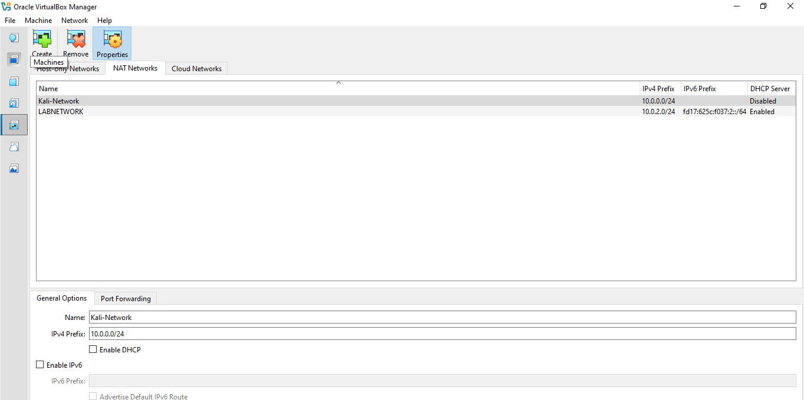
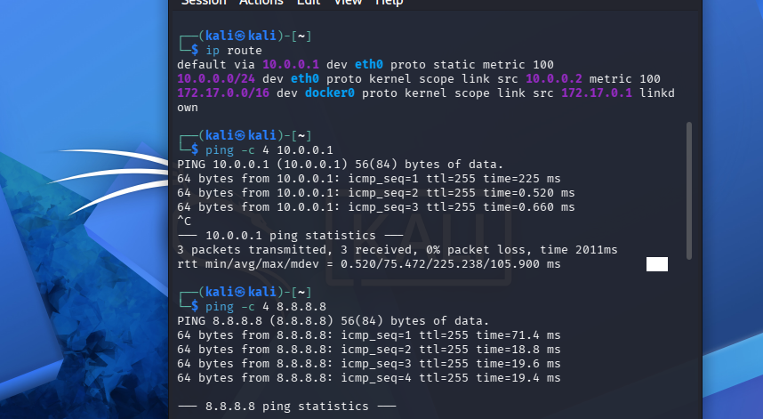
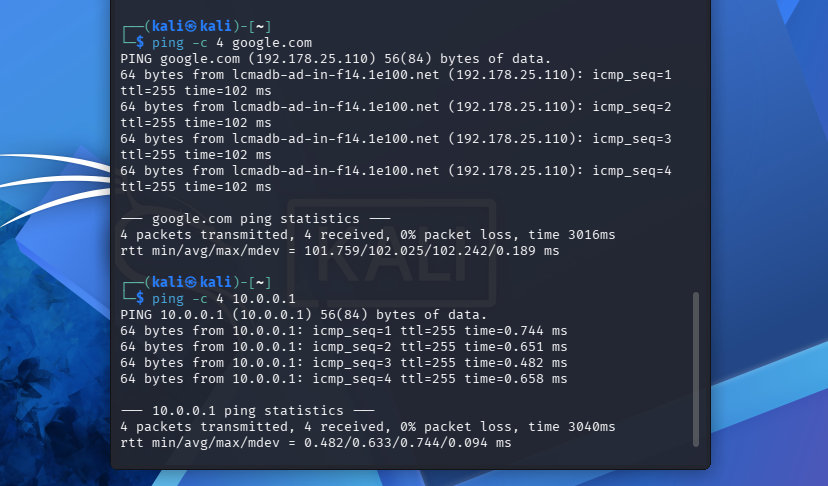

# Kali Linux Lab Setup and Network Configuration


## Project Overview

This project documents the installation and configuration of a Kali Linux virtual machine using Oracle VM VirtualBox.

It demonstrates practical experience in Linux system setup, network interface identification, IP addressing, gateway configuration, and network connectivity testing.

## Objectives

- Install and configure Kali Linux in VirtualBox.
- Identify network interfaces using Linux commands.
- Inspect IP addressing and network configuration.
- Identify the default gateway.
- Test local and external network connectivity.
- Verify DNS resolution.

## Lab Environment

| Component | Details |
|---|---|
| Operating System | Kali Linux |
| Virtualization | Oracle VM VirtualBox |
| Network Interface | eth0 |
| IPv4 Address | 10.0.0.2 |
| Subnet | 255.255.255.0 |
| Default Gateway | 10.0.0.1 |

## Commands Used

```bash
ip a
ip route
ping -c 4 10.0.0.1
ping -c 4 8.8.8.8
ping -c 4 google.com
```

## Network Connectivity Results

| Test | Result |
|---|---|
| Network interface inspection | Successful |
| Default gateway connectivity | Successful |
| External IP connectivity | Successful |
| DNS resolution | Successful |

## Lab Evidence

### VirtualBox Configuration


### Kali Linux Network Configuration


### Gateway Connectivity


## Detailed Documentation

Read the complete technical report:

[View Kali Linux Lab Report](documentation/lab-report.md)

## Key Learning Outcomes

- Linux command-line navigation and administration.
- Network interface inspection.
- IPv4 addressing and subnet identification.
- Default gateway verification.
- Basic connectivity troubleshooting.
- Technical documentation and evidence management.

## Author

**Chinedu Okoli**

Cybersecurity Enthusiast | Aspiring SOC Analyst

[GitHub Profile](https://github.com/chinedu-okoli07)

